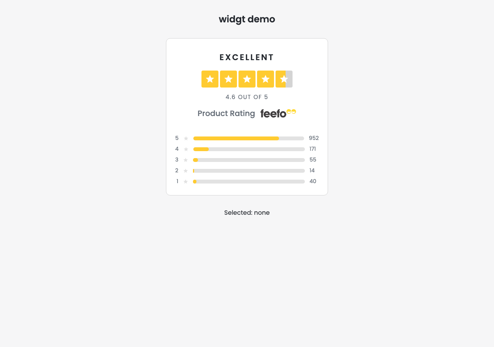
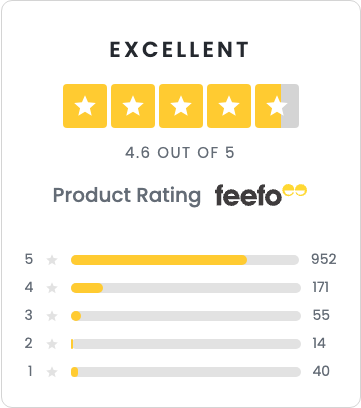

# widgt: product rating widget

Part 2 of the assessment: a self-contained product rating summary card. The widget is specified in [`docs/specs/02-widgt.md`](../docs/specs/02-widgt.md); the review harness around it in [`docs/specs/03-review-loop.md`](../docs/specs/03-review-loop.md) and [`review/README.md`](review/README.md). Styling decisions are recorded in [ADR 0001](../docs/decisions/0001-widgt-styling.md); choices the spec left open are recorded in [`docs/ASSUMPTIONS.md`](../docs/ASSUMPTIONS.md). Requires Node >= 22 (`engines` in `package.json`).

## Screenshots

The demo page at 1280px, with the widget and its selection status line:



The widget alone in its 360px reference wrapper (`/?visual=1`), the exact image the review harness compares against the reference for its visual-similarity signal:



Both are copied unchanged from `review/runs/iter-01/screenshots/`.

## Scripts

Every script in `package.json`; the review harness's own commands are documented in [`review/README.md`](review/README.md).

| Script | What it does |
| --- | --- |
| `npm run dev` | Vite dev server serving the demo page. |
| `npm run build` | `tsc -b` (type-check with project references), then `vite build` into `dist/`. |
| `npm run preview` | Serves the production build from `dist/` locally. |
| `npm run typecheck` | The same compile check as `build`, without emitting (`tsc -b --noEmit`). |
| `npm run lint` | ESLint over the whole project; a single warning fails it (`--max-warnings 0`). |
| `npm test` | The unit and component suite once (`vitest run`). |
| `npm run test:watch` | The same suite in watch mode. |
| `npm run test:e2e` | The review harness's Playwright suite (`review/playwright.config.ts`): the screenshots and axe results that `npm run review` scores. |
| `npm run review` | Runs every check once and writes `review/runs/latest/` (report.json, report.md, screenshots, diff.png); prints a summary. No AI involved. `--strict` exits 1 when a gate fails. |
| `npm run review:lock` | Rewrites `contract.lock` after a deliberate contract change. Humans only. |
| `npm run loop` | The full generate-review-fix loop, `--generator claude` or `glm` headless, or `external`, which writes the next prompt, prints instructions and exits 75. |
| `npm run verify` | `typecheck`, `lint`, `test`, then `review --strict`: the one command to run before handing anything over. |

## The demo page

`npm run dev` serves a demo page (spec 02 section 8) whose scenario is chosen by the URL:

| URL | Renders |
| --- | --- |
| `/` | The interactive widget with the selection status line beneath it. |
| `/?interactive=0` | The static widget: breakdown rows are plain list items. |
| `/?empty=1` | All counts zero: no label, and "No reviews yet" in place of the score. |
| `/?visual=1` | The screenshot page: static, white, the widget in a 360px wrapper. |

The page keeps `.page` and `.container` as plain blocks: a flex or grid parent would collapse the widget's `container-type` width to zero.

## Component tree

```text
App (src/App.tsx)                  the demo page: picks a scenario from the URL
└── ProductRating                  section root; derives the whole summary from counts
    ├── RatingLabel                "Excellent": sentence case in markup, uppercase via CSS
    ├── StarRow                    the five-star graphic; aria-hidden, decorative
    │   └── Star                   one star tile, fill 0-1 through the --fill custom property
    │       └── StarIcon           the svg glyph; aria-hidden, focusable="false"
    ├── ScoreText                  "4.6 out of 5" or "No reviews yet"; the stars' text alternative
    ├── BrandLine                  the h2 heading and the feefo logo img, as siblings
    └── RatingBreakdown            a ul of rows, 5 down to 1
        └── BreakdownRow           an li: plain content, or a toggle button when interactive
```

Everything rendered is derived once from `counts` by `summarise` in `src/domain/` (AC-7.3), which throws a `RangeError` during render on invalid counts (AC-2.3). The demo's inputs and status line live in `src/demo/` (`scenario.ts`, `data.ts`, `selectionText.ts`); each row's accessible name is built by the pure formatter `src/components/BreakdownRow/rowName.ts`.

## Styling

CSS Modules throughout; no runtime CSS-in-JS. Design tokens are custom properties declared in [`src/styles/tokens.module.css`](src/styles/tokens.module.css) on a `.tokens` class, which `ProductRating.module.css` composes into `.root`:

```css
.root {
  composes: tokens from '../../styles/tokens.module.css';
}
```

The tokens therefore resolve on the widget's own root element, and a host can override any of them there (`--widgt-color-accent` and friends) to re-theme the widget without touching its hashed classes. The widget scales with its container, not the viewport: `.root` sets `container-type: inline-size` with `max-width: 26.25rem`, and a `@container (max-width: 20rem)` query tightens the body padding in narrow containers.

## Typography

Poppins is self-hosted (A-W9). `src/styles/global.css` imports weights 400, 500 and 600 of `@fontsource/poppins` (5.3.0), and Vite bundles the woff2/woff files into `dist/assets`; `index.html` carries no font links. The page makes no third-party font request, so there is no Google Fonts CDN call (privacy/GDPR), the demo works offline, and the review screenshots render the same fonts on every run.

## Accessibility

The AC-3 group of spec 02, and how the build satisfies it:

- The card is a `<section aria-labelledby>` pointed at its own `h2`, which defaults to "Product Rating" (AC-3.1). The logo is a sibling of the heading, never inside it, so it does not extend the section's accessible name.
- The five-star row is `aria-hidden` because the score is already text: `ScoreText`'s visible "4.6 out of 5" serves as the graphic's text alternative (AC-3.2).
- The breakdown is a real `ul`/`li` list; each row's accessible name, "5 stars: 952 reviews (77%)", comes from `aria-label` (AC-3.3).
- The label is sentence case in the markup and uppercased by CSS only (AC-3.4).
- The logo `img` carries `alt="feefo"`; every decorative star graphic is `aria-hidden` (AC-3.5).
- The recorded review run reports axe clean for the default, static and selected states: zero WCAG 2.2 AA violations (AC-3.6).
- Focus outlines use `--widgt-color-focus` (dark `#25292f`) rather than the brand yellow, which reaches only 1.6:1 on white (AC-3.7).

## Interaction

`onRatingSelect` is optional (A-W1). Without it the widget is fully static: breakdown rows are plain `<li>` content with no handlers. With it, each row renders a `<button type="button" aria-pressed>`; activating a row calls `onRatingSelect(rating)`, and activating the pressed row again calls `onRatingSelect(null)`. The widget never filters anything itself; the host decides what a selection means. Passing `selectedRating` makes the choice controlled; left out, the widget keeps it internally.

## The self-reviewing loop

The harness in [`review/`](review/README.md), specified in [`docs/specs/03-review-loop.md`](../docs/specs/03-review-loop.md), scores the widget on six weighted signals behind gates G1-G6 and, under `npm run loop`, feeds each report back to a generator. The recorded run needed a single iteration: a 12.4 baseline, then 95.8/100 with every gate passing, 58/58 contract tests and 172/172 unit tests green, and axe clean in all three states. Scoreboard and per-iteration reports live in `review/runs/`.

## Deliberate deviations

Three points where the build diverges from a written source, each accepted by the review loop and left as built:

1. **The star tile's cut-out colour is a literal.** `src/components/Star/Star.module.css` uses `color: #fff` for the glyph knocked out of the tile rather than `var(--widgt-color-surface)`, although that token exists and holds the same value; the build guide's reference CSS (docs/plans/guide-widgt.md, section 8) also writes `#fff`.
2. **The container breakpoint is 20rem, not 18rem.** The guide sketches `@container (max-width: 18rem)` for tightened spacing; the built rule in `src/components/ProductRating/ProductRating.module.css` uses 20rem. All 16 responsive contract tests pass, and none pins the value.
3. **`rowName.ts` lives beside its component.** AC-7.3 places domain logic in `src/domain/`, but the row-name formatter sits in `src/components/BreakdownRow/`. The same AC allows components to hold formatting, the build guide (section 6) prescribes this location, and `src/domain/` was outside the generator's scope (master-plan D8), so relocating it was never a reviewed change.
