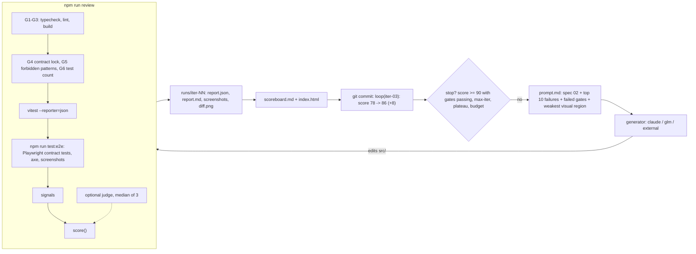

# review: the self-reviewing UI loop

The harness of [spec 03](../../docs/specs/03-review-loop.md). An AI agent builds the widget (spec 02). This folder scores each attempt with **deterministic checks the agent cannot edit**, and commits every iteration together with its score, so the history shows how the work progressed.

The AI is optional. `npm run review` needs no AI and no API key.

## How it works



The same thing in plain text:

```
baseline review -> iter-00 commit
loop:
  prompt  = spec 02 + top 10 failures (AC ID, file, message) + failed gates
            + one line naming the weakest visual region and its best offset   (never the judge)
  generator edits src/
  review  = gates G1-G6 -> vitest -> playwright contract tests -> signals -> score
  archive runs/latest -> runs/iter-NN, rewrite scoreboard.md and index.html, git commit
  stop if score >= 90 with all gates passing | max-iter | < 1 point gained twice in a row | budget spent
```

### Score (spec 03 §3)

| Signal | Weight | Source |
|---|---:|---|
| Contract tests passing | 25 | `runs/latest/contract-results.json` (Playwright JSON reporter) |
| Unit tests passing + AC coverage (mean of the two) | 15 | Vitest JSON reporter, tests in `src/` only. Coverage: the share of spec 02's 20 unit-testable AC IDs (AC-1.x, AC-2.x, AC-3.1-3.5, AC-4.1-4.6) that start the title of at least one **passing** test |
| Accessibility: mean over `default`, `static`, `selected` of `100 - 25c - 15s - 5m - 1n` (floored at 0) | 20 | `runs/latest/axe/<state>.json`. A missing or unreadable state scores 0 and is named; there is no fallback to the AC-3.6 pass rate |
| Responsiveness | 15 | contract tests whose title starts with `AC-5` |
| Visual similarity of the widget to the reference card, foreground pixels only, 0.10 -> 0 and 0.90 -> 100 | 10 | pixelmatch of `screenshots/visual-widget.png` against `reference/widget-reference.png` cropped to the card (360x405 at 20, 16), written to `diff.png`; per-region similarity and best offset (±8px) as diagnostics |
| AI judge rubric, median of 3 samples | 15 | `rubric.json` (6 criteria, 0-3 with anchors) |

- **Any failed gate makes the total 0.** The report still shows the uncapped total.
- **No widget, no a11y, responsive or visual points** (precondition, AC-L8): those three score 0 with a reason unless every AC-1.1 and AC-1.2 contract test ran and passed.
- **Judge off:** its 15 points are spread over the other signals in proportion.
- **Any other missing signal scores 0** and is listed as missing. Its weight is *not* redistributed, otherwise breaking a check would pay.

### Gates

| Gate | Check |
|---|---|
| G1-G3 | `npm run typecheck`, `npm run lint`, `npm run build` exit with 0 |
| G4 | sha256 of every file in `DEFAULT_LOCK_SCOPE` (`src/gates.ts`) matches `contract.lock`: `contract/**`, `reference/**`, `rubric.json`, `playwright.config.ts`, `src/**` (the harness), `review/tsconfig.json`, and in `widgt/` `eslint.config.js`, `tsconfig.json`, `tsconfig.app.json`, `tsconfig.node.json`, `vite.config.ts`, `package.json` and `package-lock.json` |
| G5 | no `.skip(`, `.only(`, `xit(`, `xdescribe(`, `@ts-ignore`, `@ts-expect-error`, `@ts-nocheck` or `eslint-disable` in `src/` or `review/contract/` |
| G6 | the number of tests in `src/` is not lower than in the previous run |

G5 does not scan `review/src/`: that is where the patterns are defined and tested, so it would always match itself. The generator may not edit `review/**` (tool deny list), and G4 locks `review/src/` together with everything else that decides what passes.

G4 checks itself: `checkContractLock` lives in the locked `review/src/`, so a deliberate edit could make it pass anything. It catches careless edits; deliberate ones are caught by the separation check after each generator run (`git status --porcelain` on `review/` and the configs) and the deny list.

## Commands (from `widgt/`)

| Command | What it does | Needs AI? |
|---|---|---|
| `npm run review` | Runs every check once and writes `review/runs/latest/` (report.json, report.md, screenshots, diff.png). Prints a summary. | No |
| `npm run review -- --judge claude` | The same, plus the rubric judge (`claude` or `glm`). | Yes |
| `npm run review -- --strict` | Exits with 1 when a gate fails. | No |
| `npm run review:lock` | Rewrites `contract.lock`. **Humans only**, committed together with the contract change. | No |
| `npm run loop -- --generator claude --max-iter 8 --target 90 --max-budget-usd 10` | The full loop with headless Claude Code. | Yes |
| `npm run loop -- --generator glm ...` | The same CLI pointed at GLM. | Yes |
| `npm run loop -- --generator external` | Writes the next prompt, prints instructions and exits with **75**. | No |
| `npm run loop -- --generator external --resume --note "..."` | Reviews and commits the external agent's edits, then writes the next prompt. | No |
| `npm run verify` | typecheck, lint, test, then `review --strict`. | No |

Paths can be overridden: `--contract-results`, `--axe` (the folder of `<state>.json` files), `--screenshot` (the widget screenshot), `--reference`, `--spec` (relative to `widgt/`). `npm run test:e2e` gets `REVIEW_RUN_DIR` (absolute path of `runs/latest/`) in its environment, and the Playwright config and contract helpers write every output under it (`review/runs/latest/` when it is not set).

### What the contract tests are expected to write

- `contract-results.json`: Playwright's JSON reporter.
- `axe/default.json`, `axe/static.json`, `axe/selected.json`: `{"state", "violations": [{"id", "impact", "nodes"}]}`, one per AC-3.6 state, written only once the widget rendered (and, for `selected`, the click worked). Rules are counted by impact; a raw axe result with a `violations` array is accepted too.
- `screenshots/visual-widget.png` (the widget alone in `?visual=1`, scored), `screenshots/visual-401.png` (the 401x443 frame, for people) and `screenshots/page-{320,768,1280}.png`.

All under `REVIEW_RUN_DIR`, which the harness sets to `review/runs/latest/`.

Anything missing is reported as a missing signal, never a crash.

## Running with a Claude subscription

Log in once with `claude` (Claude Code 2.1.x). No API key is needed:

```bash
claude            # log in interactively, then exit
npm run loop -- --generator claude --max-iter 8 --max-budget-usd 10
```

The generator runs `claude -p` with the prompt on stdin and:

- `--output-format json`, to read `total_cost_usd` (also reported on a subscription, where it is notional) and the final message for the scoreboard;
- `--permission-mode acceptEdits --permission-prompts none`, so edits are accepted and anything outside the allow list is denied instead of hanging;
- `--allowedTools` Read, Glob, Grep, Edit, Write and the project's own `npm test` / `typecheck` / `lint` / `build`;
- `--disallowedTools` `Edit(review/**)`, `Write(review/**)`, `Read(review/runs/**)`, the package and tool configs, and `Bash(git *)`;
- `--max-budget-usd` set to what is left of the loop's budget.

`--bare` is deliberately not used: it ignores the subscription login and only accepts `ANTHROPIC_API_KEY`.

## Running with GLM

The same CLI, pointed at Z.ai's Anthropic-compatible endpoint:

```bash
export GLM_API_KEY=...                                   # required
export GLM_BASE_URL=https://api.z.ai/api/anthropic       # optional, this is the default
export GLM_MODEL=glm-4.6                                 # optional, passed as --model
npm run loop -- --generator glm --judge glm
```

The harness maps them onto `ANTHROPIC_BASE_URL` and `ANTHROPIC_AUTH_TOKEN` for the child process only.

## Anti-gaming measures

| Risk | Measure |
|---|---|
| The generator grades itself | Generator and evaluator are separate. The score is computed by code; the judge is optional, capped at 15% and never a gate. |
| Weakening the contract, the reference or the thresholds | G4 sha256 lock over `contract/`, `reference/`, `rubric.json` and `playwright.config.ts`; the generator's tools deny `review/**`. |
| Editing the harness, a config or the packages to change what is measured | G4 also locks `review/src/**`, the ESLint, TypeScript and Vite configs, `package.json` and `package-lock.json`. The lock checks itself, so the separation check and the deny list back it up. |
| Scoring a11y, responsive or visual points without a widget | Precondition (AC-L8): those signals score 0 unless every AC-1.1 and AC-1.2 contract test passed. axe on an empty page, an empty page that never overflows and a near-white screenshot earn nothing. |
| A white page or an empty card looking like the reference | Foreground similarity (AC-L10): only pixels that are ink in either image count, compared with the reference cropped to the card. An empty bordered card scores 0.063 (0 points). |
| Pasting the reference PNG, or painting it through a canvas or a CSS image | AC-6.3 checks the widget before capturing it: exactly one `` (alt "feefo", at most 4% of the widget's area); no CSS `url()` or `image-set()` image on it, a descendant or their pseudo-elements; no `canvas`, `iframe`, `object`, `embed`, `video`, SVG `<image>`, `feImage` or image input; and the same `ariaSnapshot()` as `?interactive=0`. |
| Counting one axe violation three times, or skipping a state | The a11y signal is the mean of per-state scores; a missing state scores 0 and is named. |
| Citing AC IDs only for coverage | Coverage counts only passing tests, over the IDs unit tests can check (AC-1.x, AC-2.x, AC-3.1-3.5, AC-4.1-4.6; not AC-3.6, AC-3.7, AC-4.7 or AC-5 to AC-7, which need a browser). |
| Skipping or deleting tests | G5 forbidden patterns; G6 test count never goes down. |
| Suppressing type or lint errors | G5 bans `@ts-ignore`, `@ts-expect-error`, `@ts-nocheck` and `eslint-disable`; the ESLint, TypeScript and Vite configs are denied to the generator and locked by G4. |
| Breaking a check so its weight moves elsewhere | Only the judge's weight is redistributed. Any other missing signal scores 0. |
| Breaking a test file so its failures vanish | A Vitest file that fails to load counts as one failed test. |
| Learning to please the judge | The prompt type has no field for judge output. The judge's prose goes only to `judge.json`, and the generator cannot read `review/runs/**`. |
| Long logs drowning the signal | Only the top 10 failures and at most five lines per failed gate reach the prompt. |
| Rewriting history | One commit per iteration with its score; the loop never amends, rebases or force-pushes. |

Tool-level denies can be bypassed through a shell, which is why the gates check the outcome on disk instead of trusting the deny list.

## Layout

```
review/
  rubric.json        judge criteria (locked by G4, like contract/, reference/ and src/)
  contract.lock      sha256 per locked file (npm run review:lock)
  src/               the harness, strict TypeScript, tested with Vitest
    score.ts         pure score(), axe and visual mappings
    gates.ts         G1-G6
    signals/         collectors: contract, unit, coverage, axe, visual, presence
    judge/           NoJudge, CliJudge (claude, glm), rubric schema
    report.ts        report.md and scoreboard.md
    html.ts          runs/index.html (inline SVG, no external assets)
    loop/            stop rules, prompt builder, generators, loop runner
    review.ts        npm run review
    loop.ts          npm run loop
    lock.ts          npm run review:lock
  runs/
    latest/          the last review (ignored by git)
    iter-NN/         one folder per loop iteration (committed)
    scoreboard.md, index.html, loop-state.json
```
